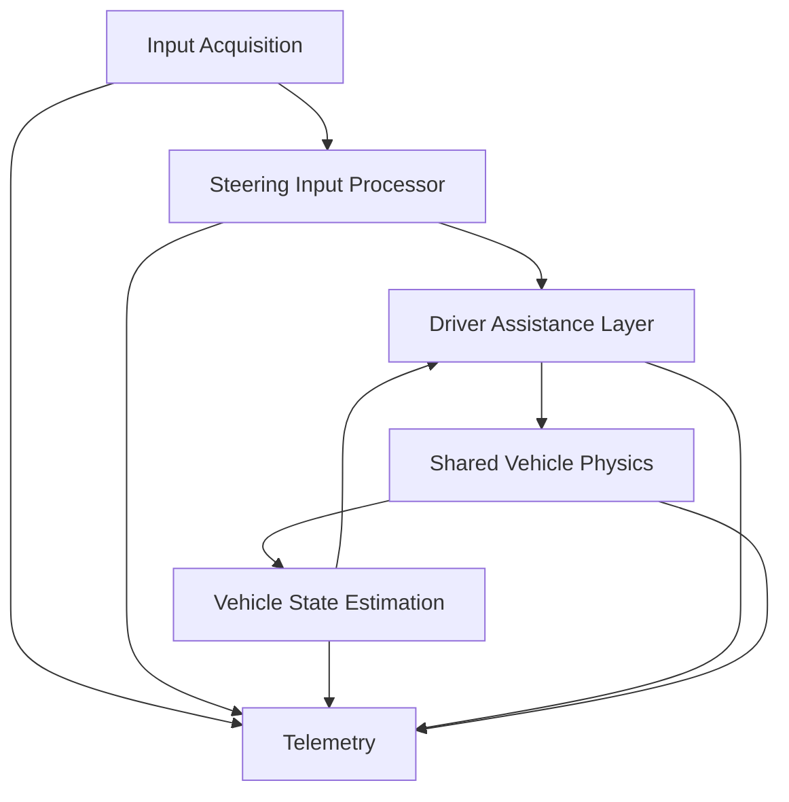

# Driving Experience System — архитектура v0.14A.2

**Актуально C0.2:** canonical DRIVING_LAB_C02_HANDOFF.md. Один будущий Countersteering Assist Off/On+strength, пока вся цепочка state/reference/slip classification толькоShadow. Архивное описание трёх профилей ниже отменено. Steering baseline C0.1 exact; предварительные recovery/drift-like фазы не прошли heldout.

**Актуально C0.1:** предыдущая концепция трёх режимов ниже отменена. Каноническое текущее описание — DRIVING_LAB_C01_HANDOFF.md, ARCHITECTURE.md и PROJECT_STATE.md. Одна будущая помощь Off/On+Strength; все новые оценки пока Shadow. Исторический контракт Stage B управления сохраняется, но Balanced/Assisted не будут реализованы как отдельные режимы.

Статус: Stage B. Simulation реализован как DrivingExperience → прежний SteeringResponse → Shared Vehicle Physics; без чтения dynamic state или поправок. Balanced/Assisted и estimator ещё не реализованы. Stage A ниже сохранён как проектный контракт. База 0.14A.1: 0ef5b8db80c325e23a11827fe370e8b031bf5c24; эталон центра 0.14A: 4b88fe85b9dfa81f9252c80923f66ff5ce90ab8e.

## Границы компонентов

Это целевая схема; сейчас слой DrivingExperience подключён, но Simulation передаёт output P без изменения в V. S и алгоритмы A ещё отсутствуют, T только наблюдает. Физика одна. Интерфейсы: value(demand,speed,dt,inputSource,vehicleState), reset(), setMode(mode), processor, command и read-only correction/assistanceState/modeCode. vehicleState зарезервирован, Simulation его не читает. setMode разрешает только simulation; same-mode сохраняет command/filter, Balanced/Assisted отклоняются RangeError без мутации. Настоящие cross-profile transitions ждут Stage C–E.

| Уровень | Фактическое состояние Stage A | Следующие изменения |
|---|---|---|
| Acquisition | controls.js: pad, digital, tilt; app.js приоритет pad → held digital → tilt. Pad хранит fraction/timestamps | Сохранить event adapters; единый снимок device/source/active/raw, очистка lifecycle |
| Processor | SteeringResponse: A.1 curve/filter, physical lock в Vehicle | Stage B: выделить чистый Simulation baseline; не менять сразу параметры |
| Estimation | Только read-only наблюдения в driving-diagnostics.js: скорости/направление hub; это не детектор | Отдельный vehicle-state.js: reusable snapshot, фильтры, validity, detector с гистерезисом |
| Assistance | Отсутствует, correction=0 | driving-experience.js: отдельные Simulation/Balanced/Assisted, ограниченная коррекция команды |
| Physics | physics.js/vehicle-spec.js побайтно прежние; node-beam Vehicle.step 240 Гц / внутренние 1920 Гц | Не менять solver/шины/массу/yaw ради режимов |
| Telemetry | CSV/4, 120 колонок, последние 60 секунд | Расширять только реальными сигналами детектора/помощника |

Целевой pipeline на фиксированном DT: получить последнее намерение → обновить эргономическую цель → оценить предыдущий завершённый физический state → assistance target → единый ограничитель скорости/механического диапазона → Vehicle.step. Ассистенту запрещено обходить итоговый rate limit. Избежать двойной фильтрации и двух независимых rack commands. Для Simulation output равен чистому processor output. Телеметрия после шага не участвует в расчёте следующей команды.

## Режимы: контракт, а не готовые коэффициенты

| Режим | Инициирует руление при нулевом намерении | Правильная команда | Неправильная команда | Физика |
|---|---|---|---|---|
| Simulation | Нет | Только эргономическая карта и механический rate/range | Выполняется без коррекции по скольжению | Общая |
| Balanced | Нет | При подтверждённом заносе небольшая bounded поддержка/ослабление избытка, без смены знака команды | Без исправления направления | Общая |
| Assisted | Ограниченно при надёжно подтверждённой нестабильности | Плавная bounded поддержка, driver override | Явная сильная команда водителя имеет приоритет; не гарантирует rescue | Общая |

Balanced: помощь допускается только при достаточно ненулевой команде водителя и надёжно установленном совпадении с нужным направлением. При нулевой/неверной команде новая коррекция=0; финальная команда может ненулевым образом возвращаться из-за обычной механики/фильтра, это не самостоятельное выравнивание. Вблизи смены знака уверенность теряется — отказ от помощи. Запрещено восстановление при помощи изменения velocity/yaw/позиции, grip, массы или tire parameters. Existing ABS/TCS — отдельные настройки; при сравнении фиксировать их одинаково. Simulation в Stage B реализован как отсутствие рулевой помощи; ABS/TCS продолжают независимо действовать согласно настройкам.

Assisted: требует отдельного Stage D и тестов намерения/override. Ограниченная steering-only коррекция не удерживает дорогу, не знает идеальную траекторию, не телепортирует машину. Коэффициенты не выбирать сейчас. Начальный research диапазон 1–3° rack/gain .15–.30 относится к прежней гипотезе слабой помощи, а не утверждённой настройке любого нового режима.

## Сигналы, знаки и надёжность

Горизонтальные оси: forward=(sin(yaw),0,cos(yaw)), basis right=(cos(yaw),0,-sin(yaw)); U=vx*sin(yaw)+vz*cos(yaw), V=vx*cos(yaw)-vz*sin(yaw). Beta=atan2(V,U) — body sideslip, не tire alpha. Положительный yaw поворачивает +z к +x. input.steer положительный имеет противоположный знак rack: delta=-.57*input. Не переводить названия экранных left/right в формулы без зеркальных тестов.

Полный chassis basis учитывает pitch/roll. Front hub velocity проецируется по нему отдельно для FR/FL; atan2(Vhub,Uhub) — направление движения узла, не оптимальный counter-angle. FR соответствует x<0, FL x>0 в исходной модели; сохранять порядок CSV. Actual wheel angle включает Ackermann; tire force также учитывает toe. Existing alpha, forceLimit, fx/fy, load/contact и damage доступны по каждому колесу. forceLimit — модельный бюджет, не измеренное реальное сцепление.

Будущий desiredYaw≈U*tan(delta)/wheelbase только kinematic reference для обычного поворота, не универсальный критерий заноса. Детектор должен сопоставлять beta, yaw mismatch, front/rear alpha/contact/load, направление скорости и ввод. Большой yawRate сам по себе не нестабильность. Yaw acceleration пока unavailable; сначала проверить шум и фильтрацию на физическом шаге. Не дифференцировать редкую CSV выборку для runtime.

Будущие состояния: unreliable / stable / candidate / sliding / recovering / side-transition. Порог beta/mismatch зависит от скорости и обычного поворота; hysteresis enter/exit, короткое подтверждение во времени симуляции, фильтры с exp(-DT/tau). Численные пороги назначать в Stage C по replay/логам и зеркальным испытаниям, а не единственному порогу yaw. На низкой скорости, reverse, полёте, перевороте, nonfinite или разрушенной оси помощь отключать. Stage A forward_motion_valid — лишь доступность направления: Ubody>3m/s, up.y>.5, оба передних контакта, finite velocities/yaw. Не выдавать его за detector confidence.

## Переключение, reset и сохранение

В Stage E: отдельный persisted Driving Experience key с validation/migration; существующий driving-lab-experience-v013 и vehicle.config не перезаписывать. Balanced рекомендация/default только после ручного acceptance; до него сохранять baseline/Simulation. Диагностическое временное переключение не меняет vehicle.config. Selector не добавляется до реальной реализации профилей.

При смене режима сохранять actual command/rack, плавно уменьшать/add correction под общим rate; сбрасывать detector confidence и recovery history. Simulation не должен сохранять скрытую помощь после перехода: переходный возврат документировать как ограничение скорости механизма, а не активный алгоритм. Lifecycle reset/place/blur/hidden/pause clears input+controller и будущие estimator/assistance states. Highway rebase сохраняет скорости и физическое state, positional history переносить или сбрасывать. Teleport/restart очищает историю производных. Memory: reusable objects at 240Hz, telemetry только ~10Hz, bounded history; никаких таймеров управления независимо от physics clock.

## План проверки будущих этапов

Сохранённый полный baseline state: nodes position/velocities/masses, wheels omega/alpha/slip/contact/damage, drivetrain/clutch/gears, rack/controller/filter и estimator/assist state. Одинаковый seed недостаточен. Формировать копии одной settled машины; после старта не фиксировать скорость/yaw. Both directions, 50/150/200 и контроль250 если задано initial state, normal corrections/lane change/sharp turn, moderate/late/excess/wrong/no input, recovery/secondary skid, 30/60/120 delivery cadence, switches/reset/touch loss. Метрики recovery duration с dwell, peak beta/yaw, sign changes/secondary skid, trajectory offset, peak/integrated correction, failures. Стабильный поворот нельзя оценивать требованием yaw=0.

Ни одного результата трёхрежимного сравнения Stage A не содержит. Нельзя использовать ранее успешный scripted recovery как доказательство iPhone comfort или гарантированной физической controllability.
