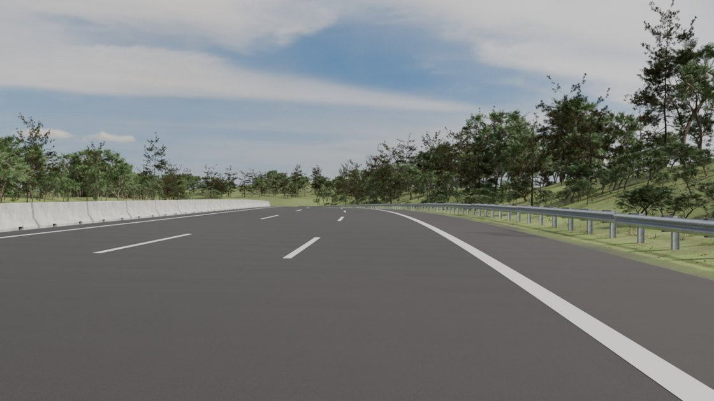

# Golden Highway Shot

**NOT READY — specific artistic defects remain.**

[Driver Eye](review/driver.jpg) · [Roadside](review/roadside.jpg) · [Same-camera R4.1c comparison](review/Driver-Eye-Before-After.jpg) · [Photographic comparison](review/A9-vs-Golden-Highway.jpg)



**Reference.** Kira Nerys photographed the A9 north of Munich, looking toward Berlin. The work uses this single dry-day target for driver-height perspective, the paved shoulder, the low maintained strip under the W-beam and the dense green backdrop. The photo's straight vista, traffic, signs and bridge differ from the empty curved study. The archived original image is 2864 × 2152. [Wikimedia Commons, public domain](https://commons.wikimedia.org/wiki/File:Auf_der_A_9_in_Richtung_Berlin.jpg)

**Art direction.** The original 48 m road, barrier modules, source geometry, two existing cameras and AgX exposure were preserved. The packed 2K Asphalt Track scan supplies the diffuse, normal and roughness at a shared nominal 1.48 m tile pitch. The original strong lane multiplier was replaced with restrained wear and a lighter paved shoulder. Paint uses the scan's fine breakup. Native broadleaf crowns and grass source meshes anchor to the right bank. A directional sun and the packed photographic sky add shadow separation. After the first renders, one focused pass increased the sky/sun separation, strengthened the asphalt response and rebalanced the right-bank crown and verge layers.

**Remaining defects.**

1. The foreground pavement still reads as a broad, largely uniform grey plane. The scan keeps the aggregate restrained, but the image lacks the varied binder, subtle polishing and shoulder weathering of the real road. A higher-quality material input would be a clean survey of actual motorway pavement paired with a separate weathered shoulder scan.
2. The grass-to-pavement edge is too clean and the maintained strip shows exposed smooth ground under the rail. The short cover needs fuller, varied sod clumps and small irregular transitions into the existing undergrowth.
3. The treeline still reads as a continuous wall in places and the bend closes the vista earlier than the photo. The nearest tall silhouettes remain sparse. A fuller mature broadleaf source and a staggered middle-distance canopy would improve depth without hiding the scene in fog.

## Reopen and reproduce

[Native Blender project](https://chatgpt.com/library?file_id=libfile_8b1f75ee596481919e719ee387a57147&account_id=personal) · [Full-resolution renders and reference](https://chatgpt.com/library?file_id=libfile_ddc3d1c6739c8191953ab291984b7690&account_id=personal)

The project was saved before rendering. The saved master reopened in Blender with all 41 file-backed images packed. Both camera matrices, focal lengths and exposure were checked against R4.1c. Extract the native archive, run `sha256sum -c SHA256SUMS.txt` in the extracted directory and open `Golden-Highway.blend` in official Blender 4.3.2 or compatible newer Blender. Driver Eye is active. The existing B camera is the Roadside inspection.

- Source master SHA-256 `1f84a2418e39050d93667a466a7d579dc2e10f88a1dbe91748e5f4327b17996b`.
- Golden master SHA-256 `9a3f1aec28f16668ae6a2d387e298d2df9721d2f7950ca6eb4d21a05145fefc9`.
- Native ZIP SHA-256 `6928513531c1f68e433b16b8b4ad6b100155568dce937a7e7b679dced13a3343`.
- Final renders are 1280 × 720 Cycles, 96 maximum adaptive samples and OpenImageDenoise. The original Driver Eye is from the preserved R4.1c artifact.

```bash
blender -b highway-master-r41c.blend --python-exit-code 1 --python edit_shot.py -- Golden-pass1.blend
blender -b Golden-pass1.blend --python-exit-code 1 --python edit_shot.py -- Golden-Highway.blend --pass 2
blender -b Golden-Highway.blend --python-exit-code 1 --python render_shot.py -- renders --width 1280 --samples 96 --denoise
```

[Asset manifest](ASSET_MANIFEST.md) · [R4.1c source Driver Eye artifact](https://github.com/maxtrcgi-glitch/Driving-Lab/actions/runs/42480836413/artifacts/13617856369)
