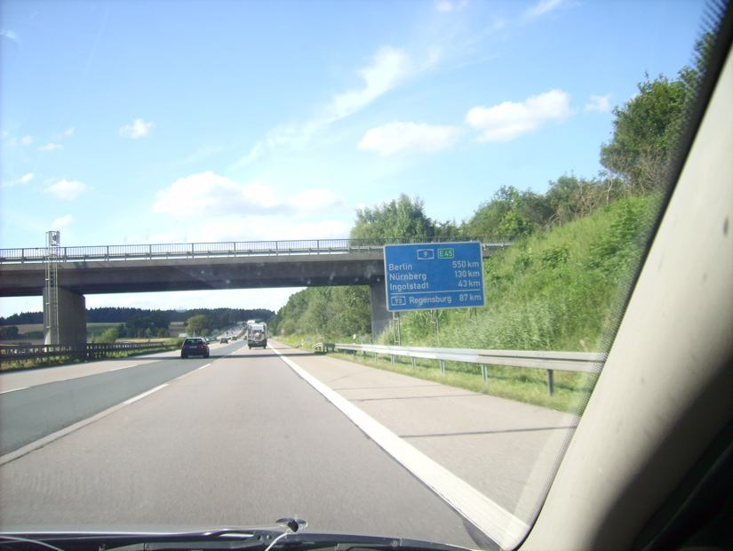
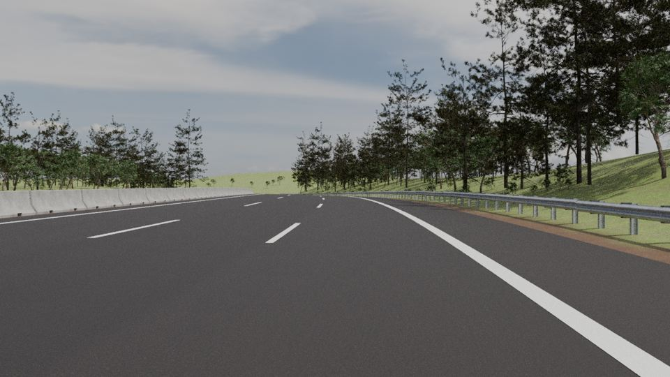
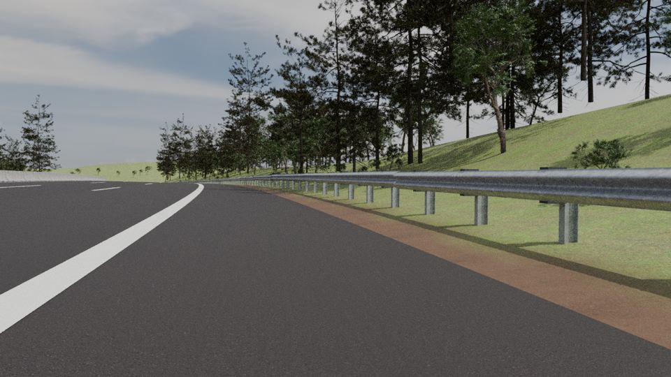
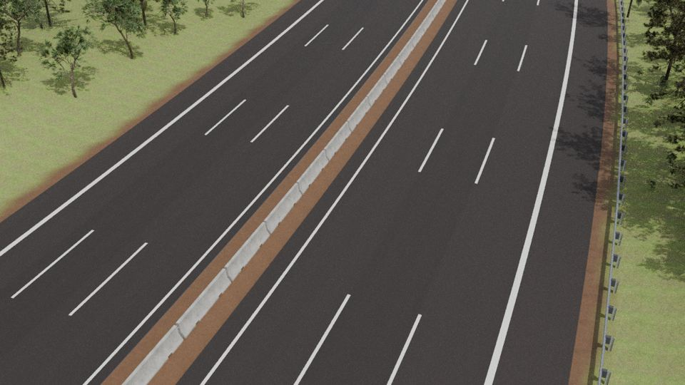

# R4.1 — Realistic Highway Master Scene in Blender

**NOT READY — SPECIFIC VISUAL DEFECTS**

The native master and all three inspection renders are complete. The motorway reads at the intended scale, but the driver view still looks like a simplified CG environment beside the A9 photograph.

| A9 reference photograph | Camera A — Driver Eye, final Cycles render |
| --- | --- |
|  |  |

The photo was taken north of Munich toward Berlin by Kira Nerys and released into the public domain. It guides the low right-lane viewpoint, hard shoulder, steel roadside rail, green embankment and dry daytime pavement. This study uses a concrete median and a wooded crest. The photograph has a steel median, bridge, road signs and traffic. The [asset and reference manifest](ASSET_MANIFEST.md) lists the three supporting photographs and the source assets. [Primary photograph and attribution](https://commons.wikimedia.org/wiki/File:Auf_der_A_9_in_Richtung_Berlin.jpg)

### Camera B — Roadside

### Camera C — Elevated Overview

### Visual assessment

- **Proportions and infrastructure.** The three lanes, broad hard shoulder, edge markings and median are legible. The final overview clears the branches that obstructed the first pass. The unchanged source dimensions of the two barrier assets are plausible in the rendered cross-section.
- **Asphalt and paint.** The surface is dry and free of an obvious repeating crack pattern. In Camera A, the road still reads as a broad, nearly uniform grey surface. The photographic reference has more variation between lanes and shoulder, while the render's paint stays uniformly clean.
- **Roadside integration.** Camera B shows several trunk bases visibly suspended above the right bank. The gravel edge still forms a near-continuous brown ribbon and the grass beneath the trees reads flat. The pale distant ridge and sparse, similarly sized silhouettes also make the horizon look staged in Camera A.
- **Lighting.** The final pass brightens the pavement and verge. The scene remains greyer than the reference and visible Cycles noise limits inspection of the fine surface grain.

### Master and reproducibility

| Item | Verified result |
| --- | --- |
| Build commit | [`9b3938e567684d95927d28e13715287d7abdf742`](https://github.com/maxtrcgi-glitch/Driving-Lab/commit/9b3938e567684d95927d28e13715287d7abdf742) on `visual/asset-poc-r2` |
| Workflow | [GitHub Actions run 42467736194](https://github.com/maxtrcgi-glitch/Driving-Lab/actions/runs/42467736194), success |
| Native project | [Download archive with `highway-master.blend`](https://github.com/maxtrcgi-glitch/Driving-Lab/actions/runs/42467736194/artifacts/13612198638) (about 400 MB). The workflow reopened the file with all three cameras and packed source images. The downloaded ZIP passed its integrity check and the `.blend` SHA-256 matched `SHA256SUMS.txt`. |
| Full renders and photograph | [Download original Driver, Roadside and Overview PNGs and the reference photograph](https://github.com/maxtrcgi-glitch/Driving-Lab/actions/runs/42467736194/artifacts/13612542319). All three PNG hashes match the workflow manifest. Report images are resized previews. |
| Render | Blender 4.0.2, Cycles, 1280 × 720 per view, up to 28 samples, denoising off on the Ubuntu build |
| Geometry | 48 m study with approach and sightline context, 630 m horizontal curve radius, 3.50 / 3.50 / 3.75 m lanes, 3.05 m right paved shoulder, 2.5% crossfall. Driver camera 1.20 m above pavement, 55.8° horizontal FOV. |
| Reused models | Innerscene W-beam 12.00 × 0.447 × 0.812 m and Jersey Barrier 4.144 × 0.610 × 0.813 m. Original Poly Haven Tree Small 02 and Pine Sapling Medium. |
| Surfaces and sky | Poly Haven Asphalt Track, Gravel Road, Leafy Grass and Kloppenheim 03 (Pure Sky), plus the barrier maps. The master contains 33 packed images and 323 vegetation instances. |

[Blender build script](build_scene.py) · [Asset fetch script](fetch_assets.py) · [Workflow](../../../.github/workflows/r41-highway-master.yml). The archive includes the provider URLs and checksums in `download-manifest.json`, repository input checksums in `scene-stats.json`, and output checksums in `SHA256SUMS.txt`.
