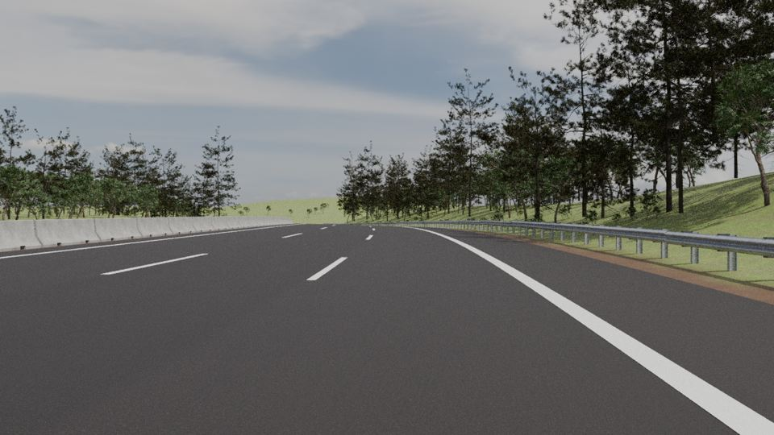
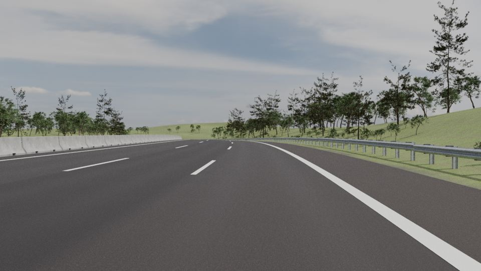
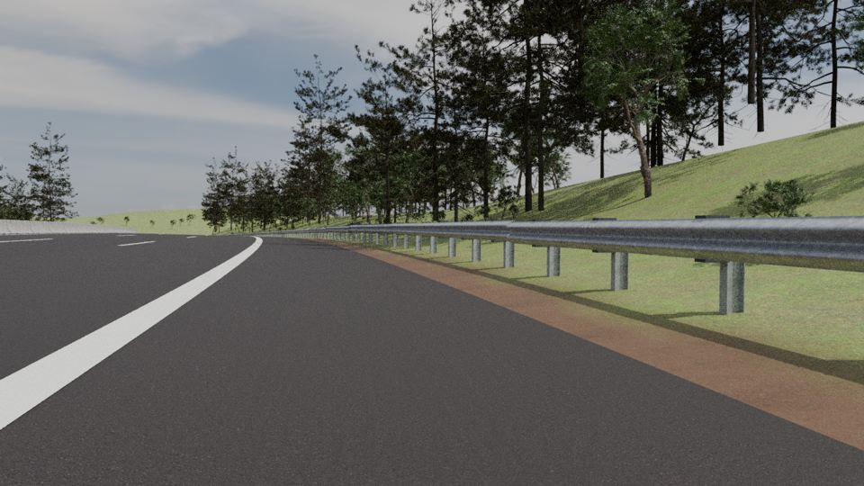
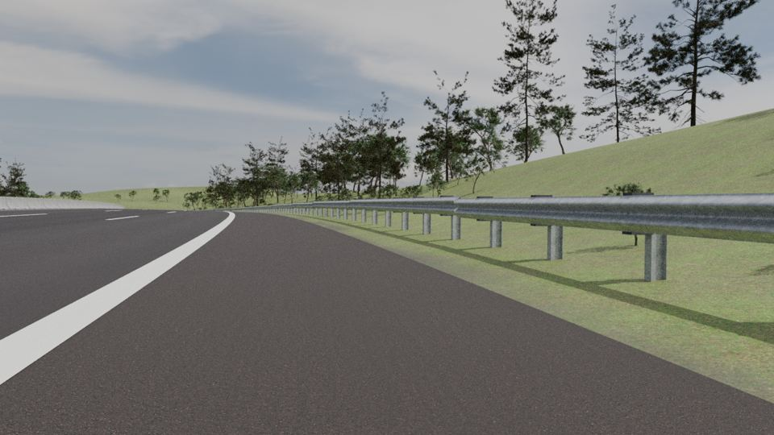
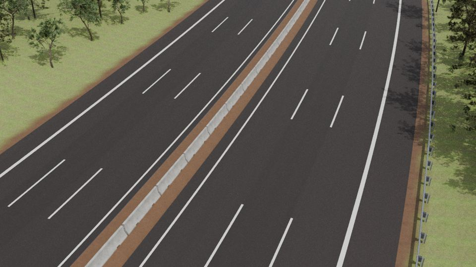
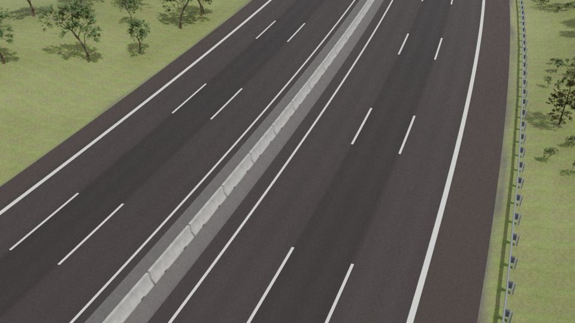

# R4.1b — Blender Master Scene Art Correction

**Delivered for Director review.** The correction removes the visible floating-trunk defect and the continuous brown verge, and makes the asphalt lanes easier to distinguish. The driver view still reads as CG in the open bank and distant ridge.

| Camera | Before · R4.1 | After · R4.1b |
| --- | --- | --- |
| Driver Eye |  |  |
| Roadside |  |  |
| Elevated Overview |  |  |

Camera transforms, lenses, AgX and exposure (+0.82) match the input master. Both sets are 1280 × 720 Cycles renders. R4.1b uses Blender 4.0.2 with up to 64 samples and adaptive threshold 0.035. The original used up to 28 samples. Denoising was off for both.

- **Pavement.** Existing Asphalt Track maps carry the lane and shoulder tones. The middle lane reads darker, the outside lane and paved shoulder lighter, and restrained wheel-path roughness varies across the lanes. The difference is clearer from above than at driver height.
- **Verge.** Patchy blending between the existing grass and gravel maps replaces the brown ribbon. Gravel at the median is now neutral grey. The W-beam modules moved vertically by −12 to +14 mm so their feet seat against the rendered terrain mesh.
- **Vegetation.** The starting pine collection contained three independent source meshes at 0, 6 and 11 m. Instancing them as one placed two variants away from the anchor used for ground contact. R4.1b instances one source-quality pine at a time and anchors its trunk base to a ray hit on the terrain. The audit found 323 placements, including 57 pines across the three variants. Tree anchors sit 3.5–9.5 cm below the sampled surface. Spacing, scale, rotation and ridge clustering were varied. No floating stems are apparent in the three final frames.
- **Remaining defects.** The roadside bank is still too smooth and sparse, with little near-ground vegetation. The distant ridge remains pale and open, and repeated broadleaf silhouettes still show in places. The paint and pavement edge remain very regular, and some fine render grain survives. The A9 photo guides dry pavement, verge and forest depth. It shows a straight road, bridge, signage and traffic, whereas the Blender study remains a curved segment without those features. [A9 photo and credits](../previews/primary-reference.jpg)

[Native master archive](https://github.com/maxtrcgi-glitch/Driving-Lab/actions/runs/42469944678/artifacts/13612719395) contains `highway-master-r41b.blend`, saved and uploaded before rendering, plus packed asset provenance and the scene audit. The downloaded archive and .blend hash were verified. [Before/after PNGs](https://github.com/maxtrcgi-glitch/Driving-Lab/actions/runs/42469944678/artifacts/13613510791) contains all six full-resolution renders and the A9 photograph. All six image hashes were verified.

[Successful GitHub Actions run](https://github.com/maxtrcgi-glitch/Driving-Lab/actions/runs/42469944678) · [Art correction source commit `74270bc8525a`](https://github.com/maxtrcgi-glitch/Driving-Lab/commit/74270bc8525ac460ce5e8d77b091151814cfcce1) · [Edit script](edit_scene.py) · [Render script](render_view.py) · [R4.1 asset manifest](../ASSET_MANIFEST.md)
