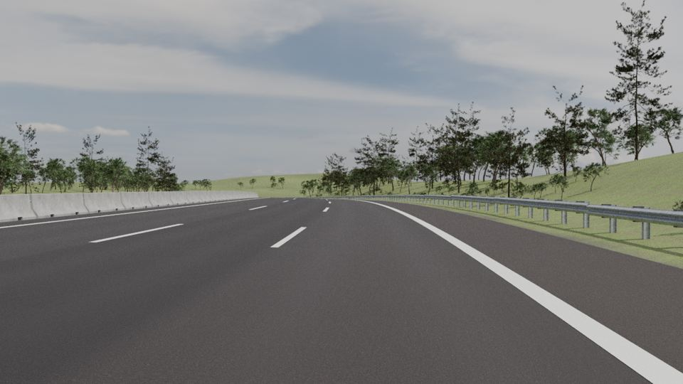
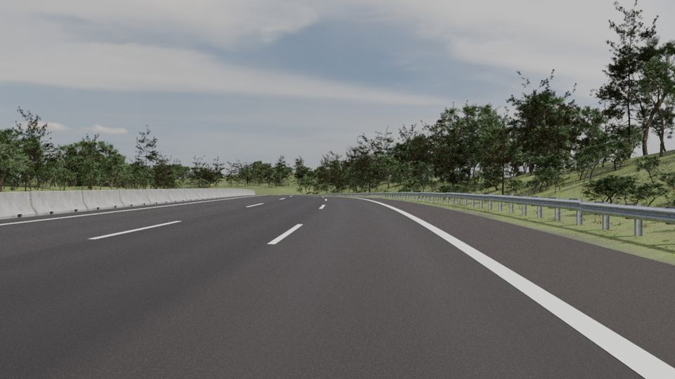
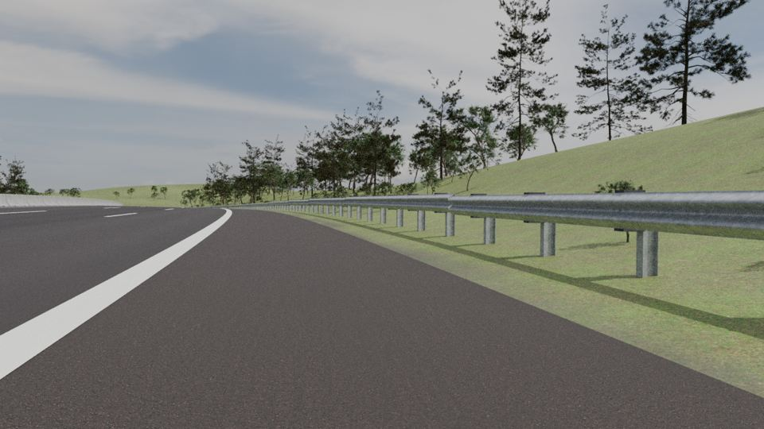
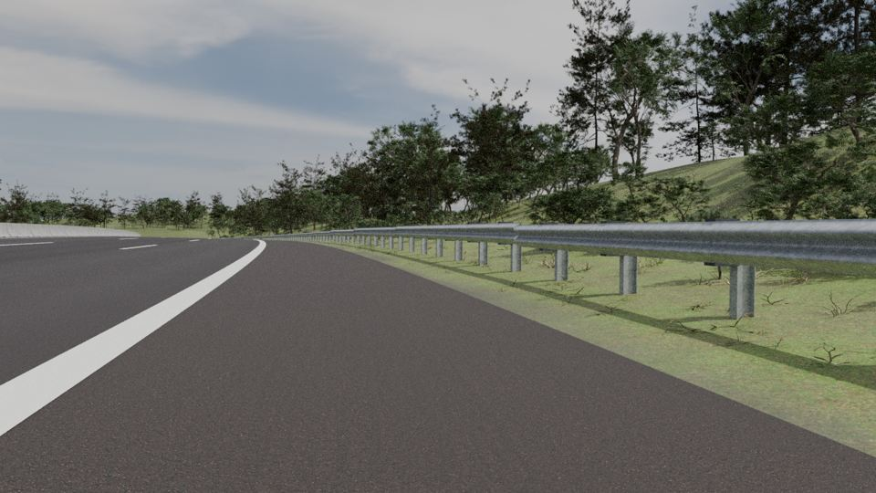
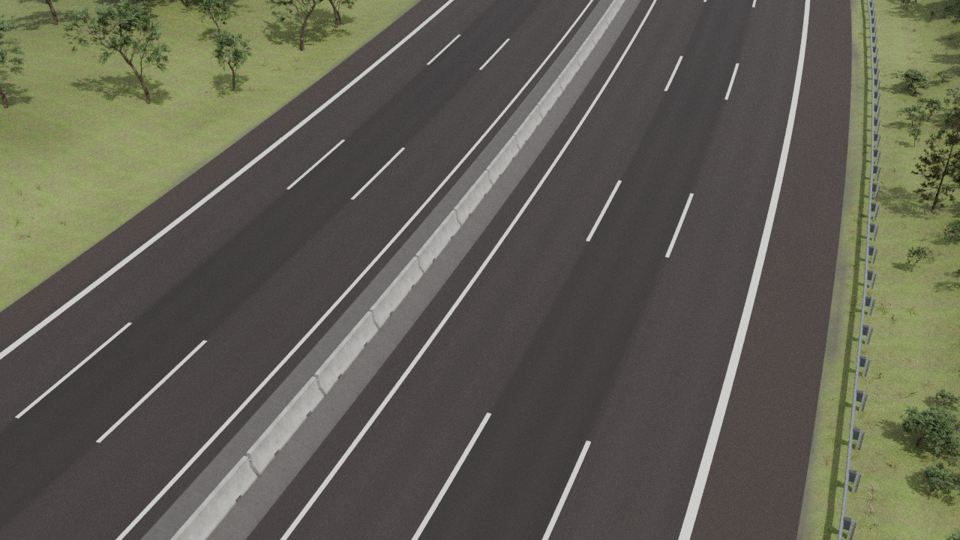

# R4.1c — Blender Roadside Environment Art

**Delivered for Director review.** From Driver Eye, the roadside and distance are visibly more natural than R4.1b. A band of low cover and scrub breaks up the open bank. Taller woodland sits behind it, and the far rise reads as a tree line with gaps instead of an empty pale hill. The unchanged road framing and exposure make these differences directly comparable.

| Camera | Before · R4.1b | After · R4.1c |
| --- | --- | --- |
| Driver Eye |  |  |
| Roadside |  |  |

### Elevated Overview · R4.1c

The [A9 photograph](../previews/primary-reference.jpg) guides the transition from a short verge to taller scrub and layered woodland. The photo shows a straight road, bridge, signs and traffic. The Blender study retains its curved road.

- **Roadside.** Relief and ground tone vary behind the clear strip. Low tufts hug the shoulder, and taller grass and scrub sit beyond the restraint. The rail and the paved shoulder remain clear in the inspected views. Anchors were placed on ray hits against the edited terrain.
- **Depth.** Added 123 scrub placements, 152 middle-distance trees and 347 trees in irregular distant stands. The grass adds 335 cut-verge and 738 bank placements. Original broadleaf and pine geometry came from the verified R4.1b master.
- **Focused correction.** The initial render showed opaque black backgrounds on the new grass cards. The final pass reopened that saved master and connected both original Poly Haven opacity maps. The visible black planes are gone in the final views. The [asset manifest](ASSET_MANIFEST.md) lists the CC0 sources. Exact files and checksums are in the native archive.
- **Remaining defects.** At Roadside distance the cut verge still looks sparse, with a smooth grass texture visible between tufts and some broad slope patches. The repeated broadleaf crown shape is still noticeable in a few groups, and the distant woodland has less canopy and tonal complexity than the reference. Some Cycles grain remains.

### Verification and downloads

Blender 4.0.2 rendered 1280 × 720 in Cycles at up to 64 samples with adaptive threshold 0.035 and denoising off, matching R4.1b. The camera transforms, lenses and +0.82 AgX exposure were checked when the checkpoint was reopened. The pavement, markings and restraints matched their source geometry and transforms during editing. The .blend hash and all six PNG hashes were checked after download.

- [Final native master and source provenance](https://github.com/maxtrcgi-glitch/Driving-Lab/actions/runs/42480836413/artifacts/13617741101) (`highway-master-r41c.blend`, about 399 MB)
- [Full-resolution before/after PNGs and A9 photo](https://github.com/maxtrcgi-glitch/Driving-Lab/actions/runs/42480836413/artifacts/13617577163)
- [Final GitHub Actions run](https://github.com/maxtrcgi-glitch/Driving-Lab/actions/runs/42480836413) · [Initial environment run](https://github.com/maxtrcgi-glitch/Driving-Lab/actions/runs/42480215507)
- [Scene edit script](edit_roadside.py) · [Asset fetch script](fetch_vegetation.py) · [Grass opacity correction](cutout/repair_grass.py) · [Final render source commit `f83197e42e84`](https://github.com/maxtrcgi-glitch/Driving-Lab/commit/f83197e42e84ae0476a76fca3b8dd4b3e4f4e81e)
