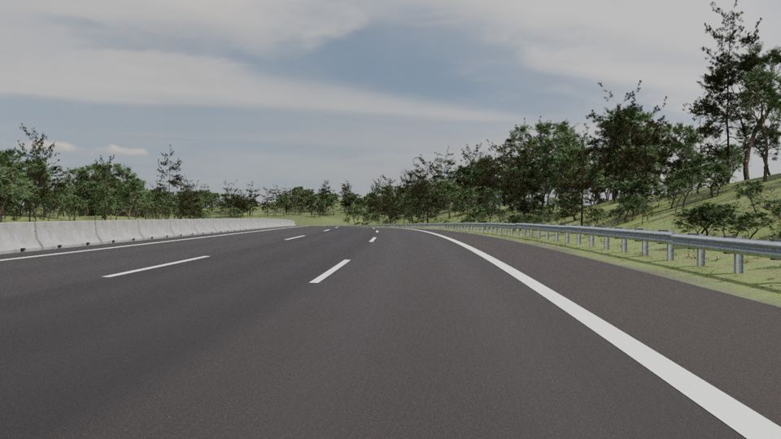
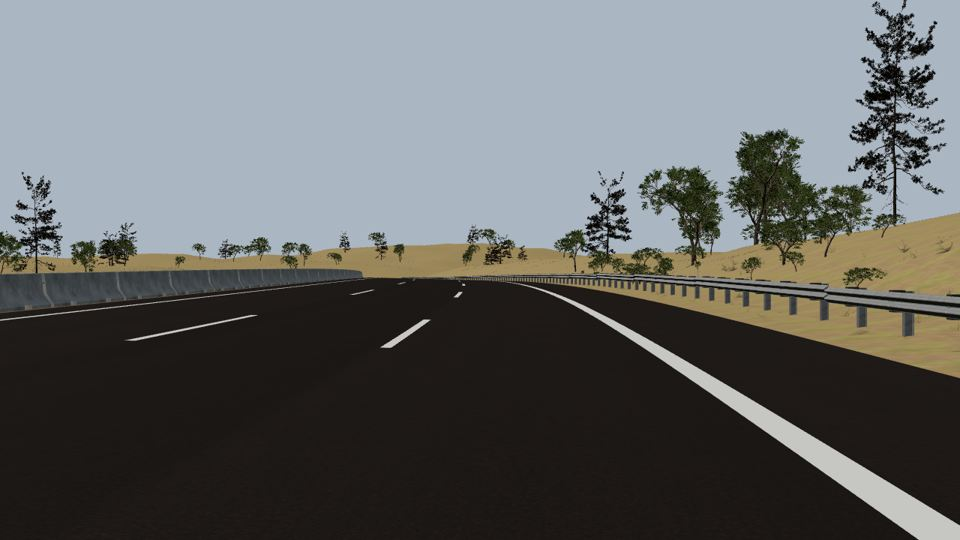

# R4.2 — Blender to Three.js visual fidelity test

**Result: PARTIAL — fidelity acceptance not met.** The existing R4.1c master exported to GLB, and Chromium loaded and rendered the result without reported JavaScript or WebGL errors. The final images show major material and environment differences.

| Blender R4.1c · Cycles | Three.js · Chromium WebGL 2 |
| --- | --- |
|  |  |

The camera world transform and 34 mm lens/FOV are taken from the Blender master, converted from Blender Z-up to glTF Y-up. The Blender image contains the complete art scene; the export deliberately contains a representative vegetation sample and the complete road and terrain sightline. The comparison therefore does not isolate rendering differences from vegetation omission.

## Findings

- Road markings, curvature, guardrails and median are recognisable and occupy corresponding image positions. The full exported world bounds are approximately 339.75 × 465.58 × 25.91 m. Those bounds are not a direct independent measurement of the 48 m study.
- Asphalt is nearly black in WebGL and lane-to-lane wear is much less visible than in Blender. The embankment is yellow-brown instead of green. The initial export was worse, with a brown roadside. For the final export, copies of the asphalt and terrain materials reconnect their original diffuse and roughness maps to Principled BSDF. The source master is unchanged. Blender's layered color attributes, terrain masks and tone adjustments were not baked, so the simplified PBR graphs do not preserve the complete material appearance.
- The viewer uses a flat background, hemisphere light, directional light and ACES tone mapping. The Blender reference uses the packed HDRI and AgX at +0.82 EV. They do not have calibrated equivalent lighting, sky or tone mapping. This probably contributes to the brightness and color mismatch, in addition to the unsupported material graphs.
- The exported vegetation is noticeably sparser because the scene was sampled. Individual trees and foliage are visible. There is no obvious black foliage-card rectangle in this overview, but the single view cannot validate every leaf, grass alpha, UV or normal map. The Blender exporter logged repeated warnings that multiple image nodes share a texture and the glTF sampler uses the first one.
- Texture statistics show sRGB color maps and non-color normal/roughness maps. All 705 reported meshes have UVs and normals; 3 materials use transparency or alpha testing. There were no recorded JS/console errors and WebGL reported error 0. These checks establish presence, not pixel-level texture or normal-map fidelity.

## Measured baseline

| Metric | Result |
| --- | --- |
| GLB | 413,009,144 bytes (approximately 394 MiB) |
| Meshes / materials | 705 / 17 |
| Triangles | 212,726,251 across loaded mesh instances, not unique source triangles |
| Draw calls | 685 for the measured render |
| Texture objects | 41, at 1024² or 2048²; duplicate uses are counted separately |
| Estimated texture memory | 430,615,211 bytes (about 411 MiB) assuming uncompressed RGBA8 and full mipmaps. Actual GPU allocation can differ. |
| Loader timing | 4,432 ms from viewer start through loader resolution, scene traversal and render submission. This does not wait for the GPU or screenshot. |
| End-to-end workflow | Approximately 5 min 52 sec for the Node capture step on GitHub's software SwiftShader renderer, including the canvas readback. This is not an iPhone benchmark. |
| WebGL / errors | WebGL 2.0 Chromium; glError 0, JS/console errors empty |

Source-selection limits were 70 near woodland instances, 35 distant woodland instances and 120 grass instances, plus all selected road/terrain meshes and restraint instances. No LOD geometry was substituted. The large source-quality meshes remain the dominant geometry burden. The 413 MB GLB and slow software readback are material obstacles to a practical interactive preview.

## Artifacts and provenance

- [Native R4.1c source checkpoint](https://github.com/maxtrcgi-glitch/Driving-Lab/actions/runs/42480836413/artifacts/13617741101), verified SHA-256 `1f84a2418e39050d93667a466a7d579dc2e10f88a1dbe91748e5f4327b17996b`.
- [Final exported GLB, full-resolution Blender and WebGL images, statistics and export log](https://github.com/maxtrcgi-glitch/Driving-Lab/actions/runs/42483505858/artifacts/13618114180). The downloaded archive passed ZIP verification and the GLB SHA-256 `448d347f10a4068ee160ece275a42a95c9546b707fff1cdcdc017cc3a03ff690` matched the recorded checksum.
- [Successful final workflow](https://github.com/maxtrcgi-glitch/Driving-Lab/actions/runs/42483505858) at source commit [`1305d7249a3453c7c99be8f477d0197ef16d17ee`](https://github.com/maxtrcgi-glitch/Driving-Lab/commit/1305d7249a3453c7c99be8f477d0197ef16d17ee). [Earlier export](https://github.com/maxtrcgi-glitch/Driving-Lab/actions/runs/42482391076) timed out during screenshot; [recovery](https://github.com/maxtrcgi-glitch/Driving-Lab/actions/runs/42483078058) captured it from the WebGL canvas before the material adjustment.
- An isolated HTTPS showcase was not published for this checkpoint. The reproducible Three.js viewer is included in the branch and the GLB is available as the workflow artifact.
