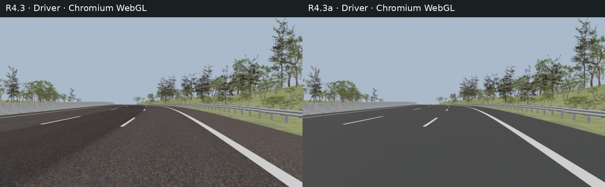

# R4.3a asphalt · WebGL review

**PARTIAL — preview published for iPhone inspection.** The dark middle lane, coarse visual noise and visible scale break are gone in the matched Chromium frames. The corrected road looks too uniform at low angles. Fine aggregate is difficult to resolve in the Roadside foreground, and the paved shoulder barely separates from the travel lane. The screenshot evidence supports the correction to continuity and colour, with surface character still below the requested art standard.

[Private HTTPS showcase](https://driving-lab-r43-highway.maxtrcgi.chatgpt.site/) · [Original successful Actions run](https://github.com/maxtrcgi-glitch/Driving-Lab/actions/runs/43408380494) · [Standalone viewer and GLB](https://chatgpt.com/library?file_id=libfile_f18bc6174b4c8191841c549a49fff4ea&account_id=personal)

[Overview before and after](r43a-review/overview-comparison.jpg) · [Roadside before and after](r43a-review/roadside-comparison.jpg)

The six captures came from the completed run and use matched cameras and viewer lighting. GitHub's artifact quota blocked the ZIP upload, so the review pairs use the actual WebGL frames preserved as JPEG previews in the job log. No rendering or export was restarted for this review.

| Chromium result | R4.3 | R4.3a |
| --- | ---: | ---: |
| Driver Eye draw calls | 264 | 264 |
| Driver Eye submitted triangles | 16,250,523 | 16,250,523 |
| GLB bytes | 26,058,916 | 25,235,612 |
| Estimated texture memory | 109.53 MiB | 77.53 MiB |
| JavaScript / WebGL errors during capture | 0 | 0 |

The existing diagnostic measured approximately 20.5 longitudinal px/m on the northbound 48 m baked Base Color and Roughness, falling to 3.0 px/m in the continuation. All corrected paving channels use a repeating 1,024 px tile across 1.075 m, approximately 953 px/m measured in plan. This review used the saved correction at `f149a69800a57f284b9da7a888d67b4708ecaf92`.

Hosted version 3 uses previously built Site source `7582646397de5b01508f986f67ed050154ea9cd6`. Both the served R4.3a page and the 25,251,416-byte GLB were verified over HTTPS. The served GLB matches the saved Site build with SHA-256 `47f43823a425ab5c3e6bbb0993e309f4b795541a956597331ec97dc3b9c36ca2`. The runner built a separate GLB with SHA-256 `dacb47e879faf9bf28b810ae7eaf688fec251f8b70073694bf314e77bfc7b12c`. Therefore the paired captures validate the committed material in CI. Device rendering and frame rate for the hosted bytes remain unverified.
