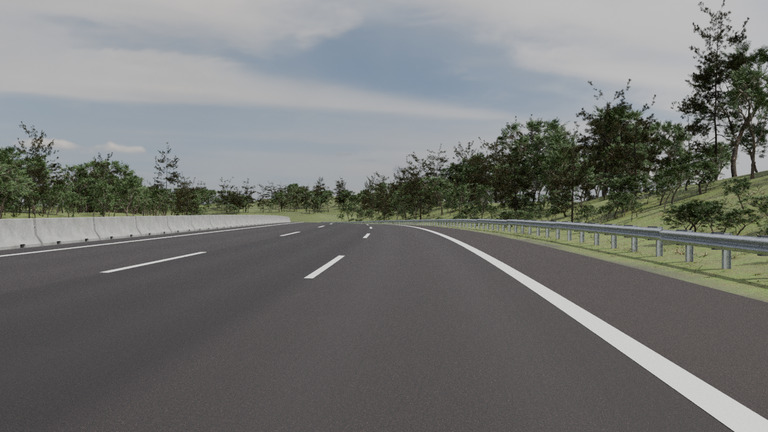
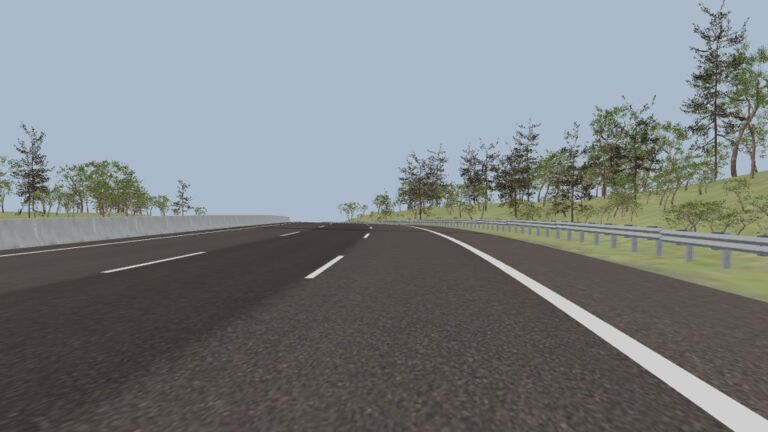

# Driving Lab R4.3 — Optimized highway

**PARTIAL.** The private HTTPS deployment is live and the Blender-derived scene rendered in Chromium. The owner-only sign-in gate prevented a signed-in browser check of the hosted build. iPhone Safari load and FPS are unmeasured. The hosted Blender 4.3.2 export and Ubuntu CI export are separate builds, so this checkpoint does not establish binary parity between them.

- [HTTPS showcase](https://driving-lab-r43-highway.maxtrcgi.chatgpt.site/) · [R4.1c native source](https://github.com/maxtrcgi-glitch/Driving-Lab/actions/runs/42480836413/artifacts/13617741101) · [Source Driver Eye PNG](https://github.com/maxtrcgi-glitch/Driving-Lab/actions/runs/42480836413/artifacts/13617856369)
- [A — Material gate](https://github.com/maxtrcgi-glitch/Driving-Lab/actions/runs/43400929996) · [B — Mesh validation](https://github.com/maxtrcgi-glitch/Driving-Lab/actions/runs/43401586097) · [C — First integrated run](https://github.com/maxtrcgi-glitch/Driving-Lab/actions/runs/43403011589) · [C — Spatial batching retest](https://github.com/maxtrcgi-glitch/Driving-Lab/actions/runs/43404185827)
- Starting HEAD `ca85e6b264821cdde6142fb411f36b9eaf7cbe38`. Final implementation tested in `d577053022027786fce5d5895d13ebb54217beb3`. The report commit changes documentation and review images only.
- Source blend SHA-256 `1f84a2418e39050d93667a466a7d579dc2e10f88a1dbe91748e5f4327b17996b`. Hosted GLB SHA-256 `eccf0621643fe8ddfdea577b07c6cc3bdb667294e0885fd9c5521caf3c17739c`.

## Visual inspection

| R4.1c master · Driver Eye | R4.3 Chromium · Driver Eye |
| --- | --- |
|  |  |

[Matched cropped Blender render](review/blender-driver.jpg) · [WebGL Roadside](review/webgl-roadside.jpg) · [WebGL Overview](review/webgl-overview.jpg)

The original cameras, 48 m high-detail road, markings, median and W-beam profiles carry through. Stage A confirmed grey asphalt, green verge and a visible HTTP 404 failure before B or C. Surface colour and roughness layers were baked without illumination, using separate UVs for baking and the tiled normals. The export uses the grass normal on terrain where Blender blends multiple normals. Foliage retains alpha textures and uses double-sided cutout rendering. Repeated geometry uses GPU instances.

The asphalt aggregate reads stronger and browner than Cycles. From Overview the wheel tracks and the transition between study and continuation are too pronounced. The verge stays green but reads flatter, especially along the guardrail. Pine crowns and the distant tree line are thinner than the master. The WebGL background is a flat sky approximation.

## Geometry and resource usage

| Source mesh | Source triangles | Optimized triangles |
| --- | ---: | ---: |
| Broadleaf | 2,062,487 | 58,000 |
| Pine A | 2,662,894 | 47,999 |
| Pine B | 1,872,357 | 48,000 |
| Pine C | 1,502,888 | 48,000 |
| Metal guardrail assembly | 2,212 | 2,212 |
| Concrete barrier assembly | 1,268 | 1,268 |

The HTTPS package transfers approximately 28.1 MB of scene and browser files before HTTP compression, including a 25.94 MB GLB. The platform's 25 MiB single-file cap required reducing the non-asphalt normal map resolution. GitHub Actions artifact upload reported an exhausted storage quota. Chromium comparison frames survive in the run logs and in the report links. Run the standalone package with `python3 -m http.server 8173` from `showcase/`.

[Download viewer and GLB](https://chatgpt.com/library?file_id=libfile_c31010a9293c81919681ee8d19229896&account_id=personal) · [Download uncompressed material bakes](https://chatgpt.com/library?file_id=libfile_fd6fc7f0de4081918493dab5a6e6bb5d&account_id=personal)

| Chromium SwiftShader camera | Draw calls | Submitted triangles |
| --- | ---: | ---: |
| Driver Eye | 264 | 16,250,523 |
| Roadside | 216 | 14,523,939 |
| Overview | 94 | 8,110,884 |

CI GLB was 26,058,916 bytes with 65 Three.js texture objects and an estimated 109.53 MiB of RGBA texture memory including mipmaps. The local CI server reached the end of asset preparation in 644 ms, before first-frame capture. The three captures reported zero JavaScript and WebGL errors. An injected 404 displayed a terminal load error. Spatial batching traded draws for fewer submitted triangles versus the first C run, especially in Overview. Driver Eye remains too geometry-heavy to infer mobile performance from these results. CI capture timings include synchronous software screenshot readback and do not measure continuous FPS.

CI GLB SHA-256 `4e258a7dd8ca1ee96601a42fd60988fa931ea33d15f91876cd2ad1d17b90f466`. Continuation starts with a signed-in Safari load of the published folder and a Driver Eye diagnostics sample. Byte-identical deployment requires browser validation of the published GLB or a deploy from the CI output after artifact storage becomes available.
