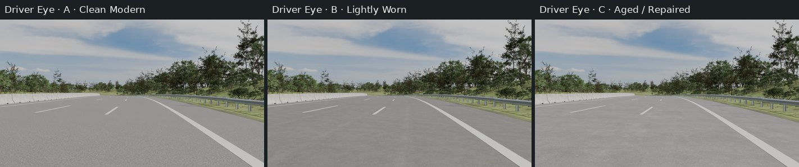
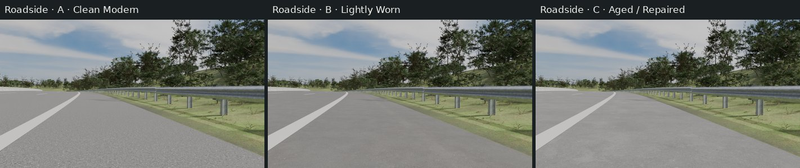
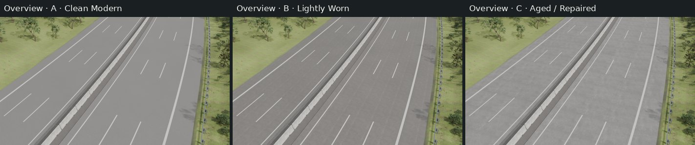

# R4.3b — Highway Asphalt Material Shootout

Three asphalt materials on the same Golden Highway scene. The three Blender scene entries reuse the same mesh data, road geometry, markings, environment, lights, world and cameras. The paving objects use object-level material links. No lane information enters the asphalt shader. The only non-scan inputs are a low-amplitude metre-scale binder variation and C's localized repair masks.

| Variant | Material | Physical scan size |
| --- | --- | --- |
| A · Clean Modern | [Asphalt Floor](https://polyhaven.com/a/asphalt_floor) · even binder and finer relief | 2.3 m |
| B · Lightly Worn | [Asphalt 01](https://polyhaven.com/a/asphalt_01) · softer tone with more visible binder wear and normal relief | 2.1 m |
| C · Slightly Aged / Repaired | [Asphalt 04](https://polyhaven.com/a/asphalt_04) blended with B, with four local resurfacing areas from the A scan | 4.0 m for Asphalt 04, source scales retained for A and B |

All scans are CC0. [Source checksums, licensing and four motorway photographs](ASSET_MANIFEST.md).

## Same-camera Cycles comparisons







Each picture is rendered at 1152 × 648 with Blender 4.3.2 Cycles, 48 maximum adaptive samples and OpenImageDenoise. Each row uses the original camera and a common focal length, exposure, lighting and render preset. The archive contains the nine full-resolution originals.

## Recommendation — B · Lightly Worn Highway

B preserves a calm mid-grey Driver Eye view while recovering visible surface texture at Roadside compared with Golden Highway. Its wear reads as light binder variation without lane-wide stains, and it shows the least distracting repeat in Overview. A has readily visible fine aggregate but reads too pale and uniform for fresh motorway asphalt. C has the most visible tonal variation and faint repairs, but its mottling repeats more clearly in the elevated frame.

The recommended B is still a little pale and matte in the preserved light. Its aggregate is subtler than A at close range, and the paved shoulder is nearly the same tone as the travel surface. Those are the main remaining material limitations.

## Restore and reproduce

[Native Blender master](https://chatgpt.com/library?file_id=libfile_bb966065d4c48191a5f5c9df497a6493&account_id=personal) · [All nine full-size Cycles renders](https://chatgpt.com/library?file_id=libfile_dbb5d7b69db4819180afb1210e2da3da&account_id=personal)

Extract the native ZIP, verify `sha256sum -c SHA256SUMS.txt` and open `R4_3b_Asphalt_Shootout.blend` in official Blender 4.3.2 or a compatible newer version. Pick A, B or C in the Scene selector. The nine paving maps are embedded. The delivered master reopened with all 50 file-backed images packed. All three scenes use the same shared pavement meshes and the same 60 independent marking objects.

```bash
python3 fetch_maps.py assets
blender -b Golden-Highway.blend --python-exit-code 1 --python build_materials.py -- assets R4_3b_Asphalt_Shootout.blend
blender -b R4_3b_Asphalt_Shootout.blend --python-exit-code 1 --python render_shootout.py -- renders
```

**Native master SHA-256** `85735250f747f08636a0dcfcb25e3deedde821cd56fb5841b1b656841b6a5bb9`

**Native ZIP SHA-256** `7112e965cc45297a2b2ed73b6a73ba97a03e04ecda6b5d0720cb08c84f3eba0d`
