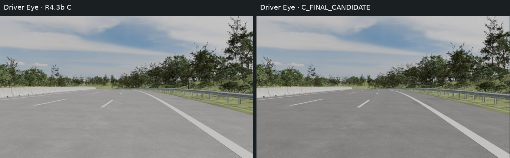

# R4.3c — C_FINAL_CANDIDATE

**NOT READY — SPECIFIC ARTISTIC DEFECTS**



[Roadside before and after](review/roadside-comparison.jpg) · [Overview before and after](review/overview-comparison.jpg) · [138 m repeat check](review/long-overview.jpg) · [Position crops at 21, 41 and 89 m](review/repeat-position-check.jpg) · [Low-angle light](review/low-angle.jpg) · [Close-up normal and roughness comparison](review/diagnostic-comparison.jpg)

The three primary pairs use the original R4.3b cameras, light, exposure and preset. The previous C PNGs are from the verified R4.3b archive. The close pair uses the same temporary camera and raking sun for both materials. Light and inspection-camera changes exist only in the render session. The native checkpoint reopened with six shared paving meshes, all 60 separate marking objects, shared original cameras and world, and all 52 file-backed images packed.

## Material and placement

- **Grain and relief.** Asphalt 04 at 4.0 m per 4K tile forms the aged base. Asphalt 01 at 2.1 m per 2K tile adds fine aggregate. Asphalt Floor at 2.3 m per 2K tile provides the recent inlay. Each scan uses its original diffuse, roughness and OpenGL tangent normal. The [manifest](ASSET_MANIFEST.md) lists the CC0 scans and actual motorway and repair photos.
- **Normals.** Decode OpenGL vectors, inverse-rotate the rotated sample back to the mesh tangent frame and normalize each crossfade. Combine aggregate detail using RNM in signed tangent space, then encode once. The saved graph was traced upstream from its Normal Map node and exercised with neutral, tilted and rotated vectors. The shallow local seam enters through a small final bump stage.
- **Wear and repairs.** Read actual lane delimiters from the independent marking meshes and generate two roughness-polishing bands per discovered lane. The travel-station envelopes vary between lanes. Three authored inlays have specific locations and shapes, with an older light patch and a darker recent shoulder patch. Three short sealed seams and intermittent outer-edge contamination are nonperiodic distance masks. The scene has no hard-braking event to justify skid marks.
- **Repeat and scale.** Offset and rotate a second Asphalt 04 sample. A slowly varying blend only selects scan samples. The full-length masks contain no aggregate. Nominal density is 1,024, 975 and 890 px/m for Asphalt 04, Asphalt 01 and Asphalt Floor. The six meshes share the same road-station UVs. At the two joins, 300 shared road-space positions match exactly. Longitudinal edge length is 0.973–1.022 physical metres per UV metre across the carriageways. Lateral density varies by less than 0.04% from nominal. The history atlas is 36 px/m.

## Remaining defects

The raking-light close-up shows finer stone relief and a readable newer shoulder inlay. The foreground binder is darker in Driver Eye, and the main evaluation views show no obvious geometry seam or change in grain scale. The main remaining defect is the weak recurring grey mottling visible over the long inspection span. The light inlay at station 41 m also has a slightly geometric silhouette, while the shoulder edge is still too even and the wheel-path polish barely reads in the main light. These remain visible art limitations after the single binder-calibration pass.

The three primary pairs are 1152 × 648 at 48 maximum adaptive samples. The repeat check is 1536 × 720. The low-angle shot and close pair are 1280 × 720 at 64 and 80 maximum samples respectively. The images are from Blender 4.3.2 Cycles with OpenImageDenoise. The low-angle comparison used an approximately 11.5° sun elevation.

## Reopen and reproduce

[Native candidate archive](https://chatgpt.com/library?file_id=libfile_694fa387935481919f2142ed4ab0d461&account_id=personal) · [All full-resolution Cycles images](https://chatgpt.com/library?file_id=libfile_5cedfa1786e8819194afffd0d19a3567&account_id=personal)

Extract the source archive, run `sha256sum -c SHA256SUMS.txt` and open `C_FINAL_CANDIDATE.blend` in official Blender 4.3.2 or a compatible newer version. Select `C_FINAL_CANDIDATE` from the Scene selector.

```bash
blender -b R4_3b_Asphalt_Shootout.blend --python-exit-code 1 --python build_candidate.py -- C_FINAL_CANDIDATE.blend surface_history.json
blender -b C_FINAL_CANDIDATE.blend --python-exit-code 1 --python audit_candidate.py
blender -b C_FINAL_CANDIDATE.blend --python-exit-code 1 --python render_review.py -- renders
```

Native SHA-256 `54ae25c6bc2e0d110a7b43f869e8e74f1d29c5011b40cdb0fad4d0f8f8a67321`

Source ZIP SHA-256 `5d75896b7ae50074e33a6b7fabb3615abcd2e70c4e1dab5eb805141b2aba303b`
