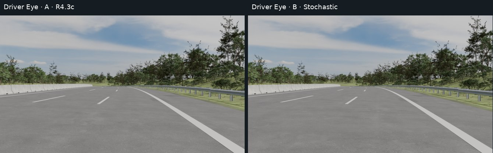

# R4.3d — C_STOCHASTIC_FINAL

**READY FOR DIRECTOR ART REVIEW**



[Roadside A/B](review/roadside-comparison.jpg) · [Overview A/B](review/overview-comparison.jpg) · [138 m A/B](review/long-comparison.jpg) · [Repeat markers and 41 m inlay](review/period-and-repair.jpg) · [Raking-light A/B](review/raking-comparison.jpg) · [Raking-light 1:1 crop](review/raking-detail.jpg)

The verified branch base is `d63b1ddf3d7287f133a74f9a7e9057ddac9492d7`. The selected material and read-back audit are committed as [`6a08577`](https://github.com/maxtrcgi-glitch/Driving-Lab/commit/6a085773093b25fd613cbbba942be3cf20e01bbb). The starting point is the verified [R4.3c native archive](https://chatgpt.com/library?file_id=libfile_694fa387935481919f2142ed4ab0d461&account_id=personal). The source scene and its material remain in the working project for A/B. Six paving meshes, their shared UV storage, all 60 marking objects, the original cameras and environment are shared. The three main views match the prior Cycles preset at 1152 × 648 and 48 maximum samples. The repeat view is 1536 × 720 at 48 maximum samples. The raking close-up is 1280 × 720 at 80 maximum samples. Both inspection rigs match R4.3c.

## What changed

- The existing Asphalt 04 diffuse carries the strongest evidence of low-frequency periodic mottling. In the packed map, 14.1% of the linear albedo variance lies in the first four radial harmonics, compared with 0.92% of signed tangent normal XY variance. Roughness also has a low band, but its image variation is smaller and remapped before shading. The measured road-image period is 4 m with a 2 m harmonic. The strongest original traverse is at lateral offset −6.3 m, around station phase 1.3 m modulo 4. The annotated crop shows one run of those repeated positions.
- The new node group samples three neighboring vertices of a triangular lattice, dual to a hexagonal Voronoi lattice. Feature-point IDs deterministically offset and quarter-turn the samples. Each sampled tangent normal is inverse-rotated into the shared road basis before blending. Sharpened barycentric weights sum to one and the departing vertex contribution approaches zero at cell boundaries. The lattice affects sample selection. The PBR projection stays at 4 m per tile. Diffuse, Roughness and decoded Normal use the same sample coordinates and weights.
- The underlying [Poly Haven Asphalt 04](https://polyhaven.com/a/asphalt_04), [Asphalt 01](https://polyhaven.com/a/asphalt_01) and [Asphalt Floor](https://polyhaven.com/a/asphalt_floor) are the existing CC0 inputs. Their nominal densities are 1,024, 975 and 890 px/m respectively. [R4.3c manifest and source references](../r43c-asphalt/ASSET_MANIFEST.md).
- The 41 m repair keeps a straight transverse saw cut, with a restrained angled return and partial seal. Its lighter old binder is closer to the surrounding road and roughness now follows the same worn scan used for the inlay. This calibration applies to both older inlays. Only the 41 m area changes in the location atlas. Wheel and recent-repair channels are byte-identical and contamination still uses its original map.
- The decoded OpenGL normals are normalized after weighted blending. The original aggregate RNM stage is retained. The saved graph was checked for coherent PBR inputs and the shared weight kernel was checked across triangle and lattice edges. Original road-space UVs were retained as the same data on each linked mesh. The baseline 300 matched join positions therefore remain exact, with the original 0.973–1.022 longitudinal physical metres per UV metre on the curve.

## Results

The same-machine repeat measurement uses detrended rendered 8-bit luminance measured every 0.1 m along six paths, away from markings. Amplitude is RMS across paths. See [raw measurements](stochastic_trial_measurements.json).

| Station period | R4.3c | Offsets only | Final offsets + quarter-turns |
| --- | ---: | ---: | ---: |
| 4.0 m | 2.088 | 0.514 | 0.467 |
| 2.0 m | 1.456 | 0.721 | 0.371 |
| 2.1 m | 0.342 | 0.480 | 0.315 |

The 4 m and 2 m components fell by 77.6% and 74.5% respectively against R4.3c. The quarter-turn correction nearly halved the residual 2 m peak from the offsets-only pass. Driver Eye shows weaker repeated grey patches. The overhead image shows no obvious cell outlines or paving joins. At 1:1 under raking light, aggregate edges remain legible. High-pass luma RMS on that crop falls from 4.07 to 3.90 in 8-bit units, consistent with slightly lower microcontrast.

**Remaining defects.** Broad, faint grey clouding is still visible from directly above, with residual peaks near 4.37 m and 3.82 m. Near the camera the paved shoulder reads much like the adjoining lane. The 41 m repair has a better-integrated binder tone, though its straight saw cut and straight return still read as geometric in the overhead crop.

## Cost and future runtime

The reusable three-sample group replaces the two old Asphalt 04 samples. Per shader evaluation the image-node count rises from 14 to 17, including two history textures and nine unique scan maps. A future Three.js implementation can share deterministic cell transforms and weights, carry the decoded vectors into the same frame, then retain RNM. Packing roughness with another linear data channel or gating the secondary wear detail by distance would be logical mobile tests. The baseline material uses 133 nodes. The final material uses 108 top-level nodes plus a 103-node reusable group. A single matched CPU run took approximately 77 s for the baseline and 85 s for the selected version, including scene setup and image saving. Cold-cache order makes this an estimate. No WebGL performance is implied.

## Reopen and reproduce

- [Native Blender source archive](https://chatgpt.com/library?file_id=libfile_75b8b695c35881918174869398947c33&account_id=personal). Download verified against ZIP SHA-256 `145bf2b7e1d656784acc2b73dc7fb8e80216dc437af8a6d895026065f9c69409`. Packed blend SHA-256 `8ef1ed282fff8068817f8629a51db153e0d17f84c4f19450a25d0669f8d213b4`.
- [Full-resolution Blender render evidence](https://chatgpt.com/library?file_id=libfile_30d725425aa081918a727d6416909ca6&account_id=personal). Ten PNGs and seven comparison sheets. ZIP SHA-256 `0d84d971c563d43479c5cd2822caacedeebcfc3158b4d9100c9aa1484ef6abd7`.

Extract the source ZIP, run `sha256sum -c SHA256SUMS.txt` and open `C_STOCHASTIC_FINAL.blend` in official Blender 4.3.2 or a compatible version. Select `C_STOCHASTIC_FINAL` in the Scene selector.

```bash
python3 refine_history.py C_Surface_History.png surface_measurements.json repair_41m.json C41_Refined_History.png
blender -b C_FINAL_CANDIDATE.blend --python-exit-code 1 --python build_stochastic.py -- C_STOCHASTIC_FINAL.blend C41_Refined_History.png
blender -b C_STOCHASTIC_FINAL.blend --python-exit-code 1 --python audit_stochastic.py
blender -b C_STOCHASTIC_FINAL.blend --python-exit-code 1 --python render_stochastic.py -- renders
```
